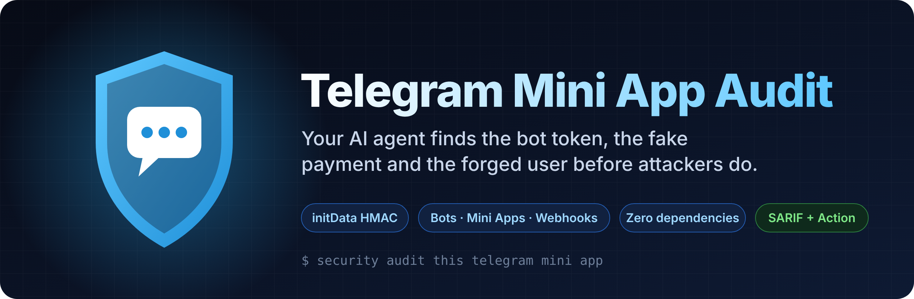
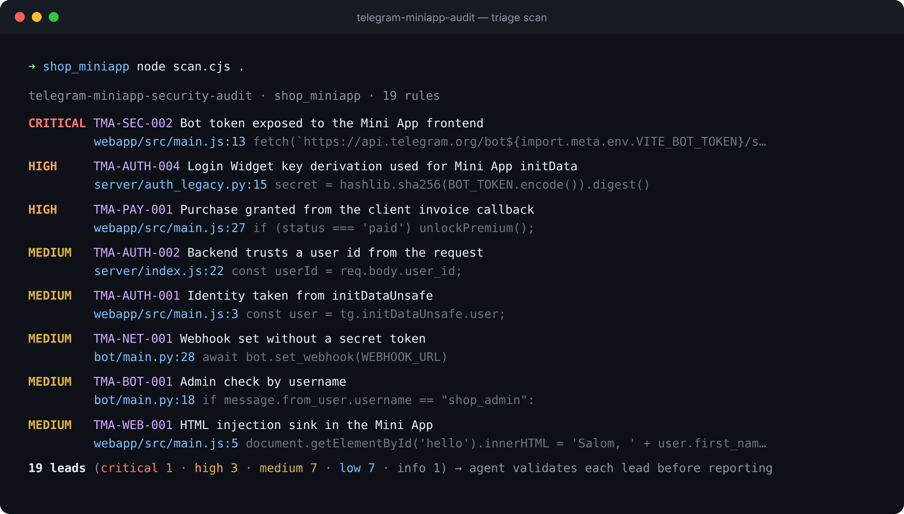

<div align="center">



<h1>Telegram Mini App Audit</h1>

<h3>Turn Claude Code, Codex or Cursor into a Telegram bot &amp; Mini App security auditor.</h3>

<p>An agent skill that audits Telegram bots, Mini Apps and their backends the way an attacker sees them,<br>
plus a zero-dependency scanner for your laptop and your CI.</p>

[](https://github.com/MBotirjonDev/telegram-miniapp-audit/actions/workflows/test.yml)
[](LICENSE)
[](#scanner-rules)
[](#3-in-github-actions)
[](CONTRIBUTING.md)

[**Quick start**](#quick-start) · [**What it catches**](#what-it-covers) · [**How it works**](#how-the-agent-audit-works) · [**Contribute**](#roadmap--help-wanted) · [🇺🇿 O'zbekcha](README.uz.md)

</div>

---

> **One prompt. Real findings. Fixes in your own stack.**
>
> ```
> security audit this telegram mini app
> ```

<p align="center"></p>
<p align="center"><sub>Real output on the intentionally vulnerable fixture in <code>tests/fixtures/vuln_app</code>.</sub></p>

## Why this exists

Telegram Mini Apps are exploding: shops, games, tap-to-earn, wallets, course platforms.
Most of them are built fast, and they break in the same handful of ways:

- the backend trusts **`initDataUnsafe.user.id`** or a `user_id` in the body, so anyone can act as anyone
- initData is "validated" with the **Login Widget** algorithm, never passes, and the check gets switched off
- a **bot token** sits in git, in a `VITE_` env var, or in a `fetch('https://api.telegram.org/bot…')` in the frontend
- the **webhook has no `secret_token`**, so anyone can POST fake updates and fake payments
- premium is unlocked when the **`openInvoice` callback** says `paid`, not on `successful_payment`
- admins are checked **by username**, which can be changed and re-registered

Generic scanners don't know any of this. This skill gives your agent a Telegram-specific
playbook **and** makes it prove each finding before reporting it.

## Quick start

### 1. As an agent skill (recommended)

```bash
npx skills add https://github.com/MBotirjonDev/telegram-miniapp-audit --skill telegram-miniapp-security-audit --global
```

Or copy `skills/telegram-miniapp-security-audit/` into `~/.claude/skills/` (Claude Code)
or your agent's skills folder. Then, in your project:

```
security audit this telegram mini app
```
```
is my initData validation correct?
```
```
check the payment flow in bot/handlers/payments.py
```

### 2. As a standalone scanner

Node 18+ only. No `npm install`.

```bash
git clone https://github.com/MBotirjonDev/telegram-miniapp-audit
node telegram-miniapp-audit/skills/telegram-miniapp-security-audit/scripts/scan.cjs path/to/your_project
```

```
CRITICAL TMA-SEC-002  Bot token exposed to the Mini App frontend
         webapp/src/main.js:13
         fetch(`https://api.telegram.org/bot${import.meta.env.VITE_BOT_TOKEN}/sendMessage`, {
HIGH     TMA-AUTH-004 Login Widget key derivation used for Mini App initData
         server/auth_legacy.py:15
         secret = hashlib.sha256(BOT_TOKEN.encode()).digest()
HIGH     TMA-PAY-001  Purchase granted from the client invoice callback
         webapp/src/main.js:27
         if (status === 'paid') unlockPremium();
MEDIUM   TMA-AUTH-002 Backend trusts a user id from the request
         server/index.js:22
         const userId = req.body.user_id;
MEDIUM   TMA-NET-001  Webhook set without a secret token
         bot/main.py:28
         await bot.set_webhook(WEBHOOK_URL)
...
```

Options: `--out leads.json`, `--sarif leads.sarif`, `--min-severity medium`,
`--fail-on high`, `--include-tests`, `--quiet`.

### 3. In GitHub Actions

```yaml
# .github/workflows/telegram-security.yml
name: telegram-security
on: [push, pull_request]
permissions:
  contents: read
  security-events: write
jobs:
  scan:
    runs-on: ubuntu-latest
    steps:
      - uses: actions/checkout@v4
      - uses: MBotirjonDev/telegram-miniapp-audit@v0
        with:
          fail-on: high        # info | low | medium | high | critical | none
          sarif: tma.sarif
      - uses: github/codeql-action/upload-sarif@v3
        if: always()
        with:
          sarif_file: tma.sarif
```

Leads then show up in the repository's **Security → Code scanning** tab.

### 4. Validate initData correctly (copy-paste)

`scripts/verify-init-data.cjs` is a dependency-free reference implementation of the
[official algorithm](https://core.telegram.org/bots/webapps#validating-data-received-via-the-mini-app),
with constant-time comparison and `auth_date` expiry. Its self-test proves it rejects
forged users, expired data, the wrong token and the Login Widget key:

```bash
node skills/telegram-miniapp-security-audit/scripts/verify-init-data.cjs --self-test
```

```js
const { validateInitData } = require('./verify-init-data.cjs');
const { user } = validateInitData(req.headers.authorization.slice(4), process.env.BOT_TOKEN, { maxAgeSeconds: 3600 });
```

## How the agent audit works

| Phase | What happens | Output |
|---|---|---|
| 0. Setup | find the bot, the Mini App and the backend; never run untrusted code or call the Bot API with found tokens | — |
| 1. Recon | assets, entry points (routes, commands, `start_param`, webhook), how identity is established, where value moves | `architecture.md` |
| 2. Triage | run the scanner, treat hits as questions | `leads.json` |
| 3. Hunt | area-by-area checklists (`checks/*.md`), parallel sub-agents if available | candidates |
| 4. Validate | a **fresh** verifier tries to disprove each candidate | confirmed / needs_validation / rejected |
| 5. Record | structured findings, checked by `validate-findings.cjs` | `findings.json` |
| 6. Report | developer-ready fixes in the project's own stack | `REPORT.md` |

Principles: only the server and the signature are boundaries; leads are not findings;
the finder never confirms its own finding; no guessed severities.

## What it covers

| Area | Guide |
|---|---|
| initData & auth: algorithm, `auth_date`, `initDataUnsafe`, IDOR | [`checks/INITDATA.md`](skills/telegram-miniapp-security-audit/checks/INITDATA.md) |
| Bot: token handling, webhook secret, admins, HTML injection | [`checks/BOT.md`](skills/telegram-miniapp-security-audit/checks/BOT.md) |
| Payments: Telegram Stars, providers, pre-checkout, idempotent grants | [`checks/PAYMENTS.md`](skills/telegram-miniapp-security-audit/checks/PAYMENTS.md) |
| Frontend: XSS, `start_param`, `openLink`, storage, CSP | [`checks/FRONTEND.md`](skills/telegram-miniapp-security-audit/checks/FRONTEND.md) |
| Backend: IDOR, referral & tap-to-earn abuse, CORS, logs | [`checks/BACKEND.md`](skills/telegram-miniapp-security-audit/checks/BACKEND.md) |

Works with any stack: aiogram, python-telegram-bot, pyTelegramBotAPI, Telegraf, grammY,
node-telegram-bot-api, Laravel/PHP, Go, Express, FastAPI, Supabase/Firebase, React, Vue,
Svelte and Flutter Web Mini Apps.

### Scanner rules

| Rule | What it looks for | Severity hint | CWE |
|---|---|---|---|
| `TMA-SEC-001` | Telegram bot token in source | critical | CWE-798 |
| `TMA-SEC-002` | Bot token exposed to the Mini App frontend | critical | CWE-200 |
| `TMA-SEC-003` | Telegram Bot API called from the frontend | high | CWE-602 |
| `TMA-AUTH-001` | Identity taken from initDataUnsafe | medium | CWE-290 |
| `TMA-AUTH-002` | Backend trusts a user id from the request | medium | CWE-639 |
| `TMA-AUTH-003` | initData validated without an auth_date freshness check | medium | CWE-294 |
| `TMA-AUTH-004` | Login Widget key derivation used for Mini App initData | high | CWE-347 |
| `TMA-CRY-001` | Signature compared with a non-constant-time operator | low | CWE-208 |
| `TMA-NET-001` | Webhook set without a secret token | medium | CWE-345 |
| `TMA-BOT-001` | Admin check by username | medium | CWE-290 |
| `TMA-BOT-002` | User-controlled text in an HTML-formatted message | low | CWE-116 |
| `TMA-PAY-001` | Purchase granted from the client invoice callback | high | CWE-602 |
| `TMA-PAY-002` | Pre-checkout query approved without checks | low | CWE-20 |
| `TMA-WEB-001` | HTML injection sink in the Mini App | medium | CWE-79 |
| `TMA-WEB-002` | start_param used as trusted input | info | CWE-20 |
| `TMA-WEB-003` | Navigation to a variable URL | low | CWE-601 |
| `TMA-STO-001` | Session or initData kept in localStorage | medium | CWE-922 |
| `TMA-NET-002` | CORS allows any origin | low | CWE-942 |
| `TMA-LOG-001` | initData or token written to logs | low | CWE-532 |

Suppress a reviewed line with `// tma-ignore: TMA-WEB-003 internal docs link`.

Tested against seven open-source Telegram projects (aiogram, python-telegram-bot,
Telegraf, grammY examples, telegram-apps, the official React template, twa-dev SDK;
about 2,600 files): **zero critical or high leads**. The remaining leads are mostly
webhook examples without `secret_token`, which is exactly what the rule is for.

## Roadmap — help wanted

- [ ] Supabase / Firestore rules that trust a `telegram_id` column without a server-issued session
- [ ] Referral credit without a self-referral check
- [ ] `requestContact` phone numbers stored without consent text
- [ ] `/start <payload>` deep-link parameters reaching SQL or `eval`
- [ ] Tap-to-earn endpoints that accept a score/energy from the body
- [ ] Ed25519 `signature` validation checks for third-party integrations
- [ ] More stacks: Rust (teloxide), C# (Telegram.Bot), Java (TelegramBots)

See [CONTRIBUTING.md](CONTRIBUTING.md). Each rule is a regex, a fixture and a test.

## Part of a toolkit

Four zero-dependency agent skills that share the same lead → validate → report workflow.
They work well together on a typical Flutter + Supabase + Telegram stack.

| Skill | What it covers |
|---|---|
| [Flutter Audit Agent](https://github.com/MBotirjonDev/flutter-audit-agent) | Security audit for Flutter & Dart apps: secrets, storage, TLS, WebViews, Firebase rules |
| **[Telegram Mini App Audit](https://github.com/MBotirjonDev/telegram-miniapp-audit)** (you are here) | Security audit for Telegram bots and Mini Apps: initData, bot tokens, webhooks, payments |
| [Supabase RLS Audit](https://github.com/MBotirjonDev/supabase-rls-audit) | Row Level Security audit: open tables, weak policies, definer views and functions, storage |
| [Flutter Release Checker](https://github.com/MBotirjonDev/flutter-release-checker) | Finds what gets Flutter apps rejected by Google Play and the App Store |

## Star history

If this saved you a leak or a rejected upload, a ⭐ helps other developers find it.

[](https://star-history.com/#MBotirjonDev/telegram-miniapp-audit&Date)

## License

MIT © Botirjon ([@MBotirjonDev](https://github.com/MBotirjonDev)). Not affiliated with Telegram.
